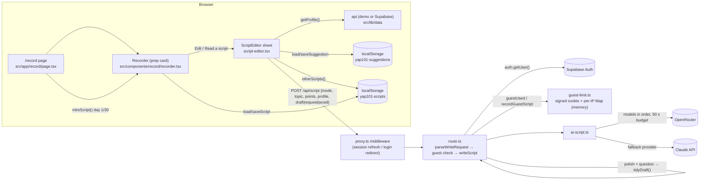

# Feature Audit: Script Editor ("Use our suggestion" / "Polish it for me")

Audit date: 2026-11-21 (UTC) · Commit under test: `2a1f30e` on `claude/ecstatic-gauss-85ydxu` · Auditor: QA agent (Claude Code)

Everything below was read from the code, not inferred from the UI. File references are repo-relative.

## 1. Stack

| Layer | Technology | Where |
| --- | --- | --- |
| Frontend | Next.js 16.4.5 (App Router, React 19.3, client components), Tailwind 4 | `src/app`, `src/components` |
| Backend | One Next.js route handler, Node runtime | `src/app/api/script/route.ts` |
| AI | OpenRouter free models (if `OPENROUTER_API_KEY`), else Claude (`ANTHROPIC_API_KEY`) | `src/lib/ai-script.ts` |
| Prompting | System brief + per-request user message | `src/lib/write-script.ts` |
| Auth / profile | Supabase (cookie session) or demo/guest mode in `localStorage` | `src/lib/data/*`, `src/proxy.ts` |
| Script storage | Browser `localStorage` only (no server copy) | `src/lib/script.ts` |
| Guest allowance | Signed cookie + in-memory per-IP map | `src/lib/guest-limit.ts` |
| Tests | Vitest 5 + Testing Library + jsdom; no E2E framework in repo | `vitest.config.mts`, `src/**/*.test.ts(x)` |

## 2. Architecture map

### Request flow, step by step

1. `/record?prompt=<id>` loads the prompt, the user's yaps and profile; personalises `{niche}`; builds the day 1/30 intro script (`introScript`).
2. `Recorder` reads a saved script from `localStorage["yap101-scripts"][promptId]`. "Read a script" opens `ScriptEditor`.
3. **Use our suggestion** (`suggest()`):
   - intro day or a cached suggestion (`yap101-suggestions[promptId]`) and no steer text → applied locally, no network;
   - otherwise `context("suggest")` (profile from `api.getProfile()`, other days' scripts) → `POST /api/script`.
   - success → cached + applied; question/redirect → shown under steer box; error → `templateSuggestion` starter.
4. **Polish it for me** (`polish()`): enabled only for the user's own text with ≥ 4 words → `POST /api/script` with `mode: "polish", draft` → success applied; error → `tidyDraft` local tidy.
5. Route: `parseWriteRequest` (trims, caps, mode rules) → demo shortcut if no key → Supabase `getUser` → guest allowance → `writeScript` → `clean()` → JSON. Guest cookie counter set only for finished scripts.
6. **Save** → `textToLines` → `onSave` → `saveScript(promptId, lines)` (localStorage) → prep card + teleprompter.

### Data stores

| Key | Shape | Written by | Read by | Limits |
| --- | --- | --- | --- | --- |
| `yap101-scripts` | `{ [promptId]: string[] }` | Save in editor | Prep card, teleprompter, `otherScripts` (sent to AI) | none; errors swallowed |
| `yap101-suggestions` | `{ [promptId]: string[] }` | AI suggestion success | "Use our suggestion" first tap | newest 40 prompt ids |
| `yap101-demo` | `{ signedIn, profile, yaps }` | demo/guest data layer | profile for prompts | — |
| cookie `yap101-scripts` (httpOnly, path `/api/script`) | `day.count.hmac` | route on finished guest script | route | 24 h |

## 3. Dependencies between components

- `ScriptEditor` depends on: `api.getProfile` (Supabase or demo), `/api/script`, `localStorage`, `sonner` toasts, `prompter.estimateSeconds`.
- `/api/script` depends on: `next/headers` cookies, Supabase auth (non-demo), `guest-limit` (process memory + `SCRIPT_LIMIT_SECRET` or the AI key as HMAC secret), the AI provider.
- Middleware `src/proxy.ts`: `/api/script` is **not** in `PUBLIC_PATHS`, so in a Supabase build a request with no session and no `yap101-guest=1` cookie is redirected (307) to `/login`.
- Prompt IDs encode level + goal (`combo*100 + day`): changing level or goal in the profile moves the user to different prompt IDs, so scripts saved under the old IDs no longer show.

## 4. Identified risks

| # | Risk | Evidence |
| --- | --- | --- |
| R1 | Guest allowance is enforceable only per server instance and per client-supplied IP header; cookie is client-held. The whole app shares one OpenRouter free quota (50 requests/day on this key), so one abuser can exhaust AI for every user. | BUG-01, BUG-02, BUG-03 |
| R2 | Scripts live only in the browser. Clearing site data, another device, or a reinstall loses them, including for signed-in users. | Code: `src/lib/script.ts` |
| R3 | Storage errors are swallowed: a failed save looks successful; unexpected stored values crash the screen. | BUG-05, BUG-06, BUG-09 |
| R4 | Server truncates drafts at 3,000 chars without telling the client. | BUG-04 |
| R5 | AI output is cleaned only for whitespace and line count; chatty preambles, markdown and long lines pass through. The model also recites coaching tips and invents stories. | BUG-07, BUG-14, BUG-16, BUG-17 |
| R6 | OpenRouter loop allows 50 s per request; the route sets no `maxDuration`. On a host with a shorter function limit the request is cut off and the user sees the fallback. | Code review |
| R7 | No CSRF/Origin check; `text/plain` cross-origin POSTs are accepted. | BUG-10 |
| R8 | Scripts are stored under one device-wide key, not per user: they survive sign-out and "Delete my guest data", show to the next person, and are sent to the AI in their requests. | BUG-18, BUG-19 |
| R9 | One shared free AI quota; it ran out after ~30 requests in this audit. | BUG-20 |

## 5. Missing or unclear requirements (need product-owner decisions)

1. **Remaining allowance:** guests are never told how many AI scripts they have left; they find out only when blocked.
2. **Cross-device persistence:** should signed-in users' scripts sync to Supabase?
3. **Maximum draft length** for polish: the UI warns at 60 s spoken (~150 words) but allows any length; the server silently cuts at 3,000 chars.
4. **Profile change:** should cached suggestions be invalidated when name/niche/goal change?
5. **Guest-to-account conversion:** what happens to a guest's local scripts when they sign up (prompt IDs may change with level/goal)?
6. **Languages:** must polish keep the user's language? (The brief says "keep their language".)
7. **Allowance window:** UTC day vs the user's local day.
